  

  

  

  <picture>
    <source media="(max-width: 540px)" srcset="./assets/profile/technical-mobile.svg" />
    
  </picture>

  

<!-- Replace these placeholder URLs with your contact details before publishing. -->

  <a href="https://www.linkedin.com/in/your-linkedin-handle">LinkedIn</a> &nbsp;·&nbsp;
  <a href="mailto:your.email@example.com">Email</a> &nbsp;·&nbsp;
  <a href="https://your-portfolio-url.example.com">Portfolio</a>

